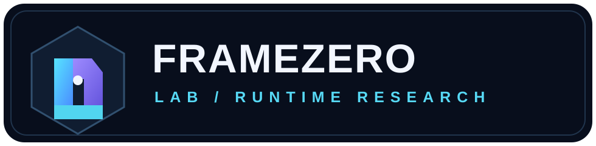

# FRAMEZERO LAB

  

  <strong>Independent Runtime & Graphics Research</strong> 
  Reproducible engineering tools, local diagnostics, and compatibility experiments.

> [!IMPORTANT]
> FRAMEZERO LAB is a developer workbench, not a finished game, a playable GTA VI PC port, or an official Rockstar, Take-Two, Microsoft, or Xbox project. Its current engine dependency is the separately maintained Leonida project, pinned as a Git submodule. The engine's upstream-reported progress is not a FRAMEZERO test result.

## What this repository provides

- **FRAMEZERO CLI** — system diagnostics, repository status, recursive submodule verification, and a carefully scoped front end for upstream commands.
- **Desktop console** — a local GUI for diagnostics, package validation, build profiles, output streaming, and process cancellation.
- **Reproducible source baseline** — the engine remains an external Git submodule at a recorded commit; no upstream history is copied or claimed.
- **Integrity checks** — unit tests, compile checks, recursive submodule validation, and scans that help keep proprietary game data out of version control.
- **Engineering documentation** — architecture boundaries, supported workflows, evidence standards, roadmap, and third-party notices.

FRAMEZERO-owned tools do not download, decrypt, extract, or distribute game content. Any upstream workflow must be used only with inputs the user is legally entitled to access and that are already readable locally. Protection bypass, key extraction, DRM circumvention, and redistribution of game data are out of scope.

## Quick start

Clone the repository with all nested dependencies:

~~~sh
git clone --recurse-submodules https://github.com/parsa2951388/framezero-lab.git
cd framezero-lab
python framezero.py doctor
python framezero.py verify
python framezero_gui.py
~~~

If you already have a checkout:

~~~sh
git submodule update --init --recursive
python framezero.py verify
~~~

The older **nova.py** and **nova_gui.py** entry points remain as compatibility shims for existing local shortcuts. New instructions use the FRAMEZERO names.

## CLI

~~~sh
python framezero.py --version
python framezero.py status
python framezero.py doctor
python framezero.py doctor --json
python framezero.py verify
python framezero.py engine-help
python framezero.py build --find
python framezero.py build --check
~~~

- **status** reports the local source pin and initialization state.
- **doctor** checks available tools, tool versions, the engine checkout, the nested dependency, and free space on the repository volume.
- **verify** checks that recursive submodules are initialized and match their committed Git links.
- **engine-help** and **build** forward arguments to the pinned upstream engine. That engine's documentation remains authoritative for its flags and behavior.

## Desktop console

Launch with:

~~~sh
python framezero_gui.py
~~~

The desktop console provides overview, diagnostics, and build tabs. It streams command output, prevents concurrent jobs, supports stopping a running child process, and escalates to a forced stop if needed. It does not include a game-launch action.

## Prerequisites and storage

The pinned upstream documentation currently lists Windows 10/11 x64 as its primary build environment, Python 3.12+, .NET 8 SDK, Vulkan SDK tools (spirv-as and spirv-val), LLVM 21+ with the AMDGPU target for llvm-mc, and Visual Studio 2022 with the Desktop C++ workload and Windows SDK 10.0.26100+ for the runtime stage.

Upstream storage estimates are approximately 30 GiB for check, shaders, and runtime stages and 400 GiB for its full pipeline, including a large optional asset-export phase. These are upstream estimates, not guarantees. Confirm the current upstream documentation and your actual available work/output volumes before starting any build.

## Evidence and project status

Every public status statement must be labelled accurately:

- **FRAMEZERO-tested** — reproduced in this repository's own CI or a documented local test.
- **Upstream-reported** — stated by the pinned upstream project, not independently reproduced here.
- **Unverified** — not yet measured or tested.

At the current pinned baseline, the upstream README says the game reaches the world phase after story loading, but the first world frame has not been verified and nothing is playable. That is upstream-reported context, not a FRAMEZERO result. See [docs/UPSTREAM.md](docs/UPSTREAM.md).

## Development and verification

~~~sh
python -m compileall -q framezero.py framezero_gui.py nova.py nova_gui.py scripts tests
python -m unittest discover -s tests -v
python scripts/verify_upstream.py
python -I scripts/check_no_game_data.py
~~~

The CI workflow also checks the upstream submodule for prohibited game-data artifacts. Never commit game executables, archives, keys, extracted assets, generated shaders, textures, models, audio, saves, or logs containing proprietary content.

## Project governance

- [Architecture](docs/ARCHITECTURE.md)
- [Roadmap](docs/ROADMAP.md)
- [Development guide](docs/DEVELOPMENT.md)
- [Desktop console](docs/GUI.md)
- [Brand guide](docs/BRAND.md)
- [Upstream provenance and status](docs/UPSTREAM.md)
- [Contributing](CONTRIBUTING.md)
- [Security policy](SECURITY.md)
- [Third-party notices](THIRD_PARTY_NOTICES.md)

## License and attribution

This repository retains the upstream engine as a Git submodule and preserves its provenance. The pinned upstream engine identifies its license as **GNU GPL v3.0**; consult its current license and every nested dependency's notices before redistribution. FRAMEZERO does not claim authorship of Leonida or the work of its contributors.

FRAMEZERO's own additions are distributed under the repository's GPL-3.0 license baseline. Product names and trademarks belong to their respective owners.
